# 

```sh
curl -fsSL https://raw.githubusercontent.com/utpalsinghdev/sysra/main/install.sh | sh
```


[](https://github.com/utpalsinghdev/sysra/releases/latest)
[](https://github.com/utpalsinghdev/sysra/actions/workflows/ci.yml)

A terminal system monitor for Linux and macOS. See CPU, memory, disk I/O, and listening ports by app instead of sorting through individual processes. If you use coding agents, sysra also shows their token usage and available plan limits.

[Releases](https://github.com/utpalsinghdev/sysra/releases) · [Changelog](CHANGELOG.md) · [License](LICENSE)

## Index

- [Screenshots](#screenshots)
- [Features](#features) · [Process grouping](#process-grouping) · [Coding agent usage](#coding-agent-usage)
- [Installation](#installation) · [Prebuilt binaries](#prebuilt-binaries) · [Build from source](#build-from-source)
- [Keybindings](#keybindings)
- [Themes](#themes) · [Built-in themes](#built-in-themes) · [Custom themes](#custom-themes)
- [Configuration](#configuration) · [Config file options](#config-file-options) · [Command-line options](#command-line-options)
- [Platform notes](#platform-notes) · [License](#license)

## Screenshots

Captured from the running terminal UI on Linux. App processes and token records in these screenshots are demo data.

### Dashboard with an expanded app

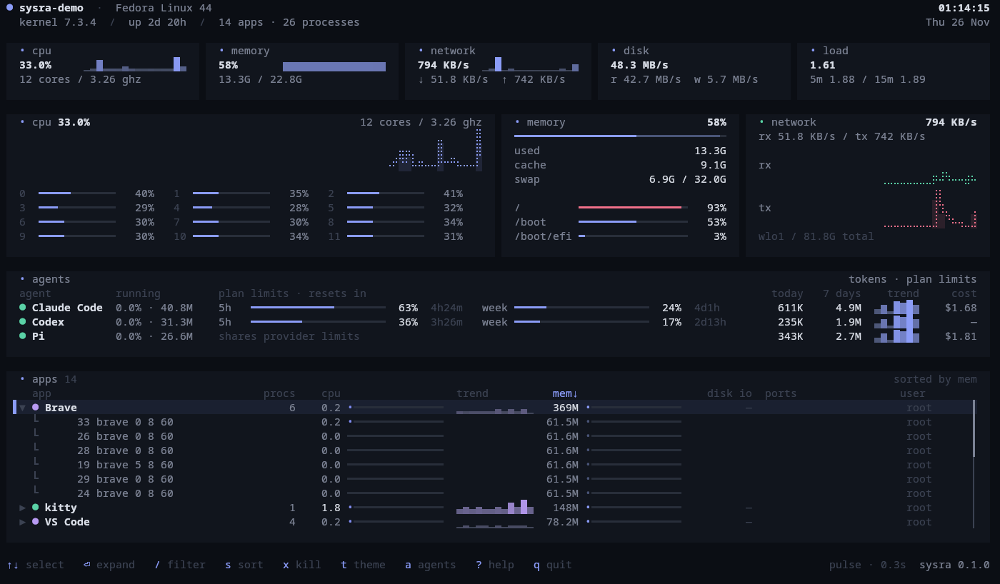

<details>
<summary>Outlined panels and the help menu</summary>

#### Catppuccin with outlined panels

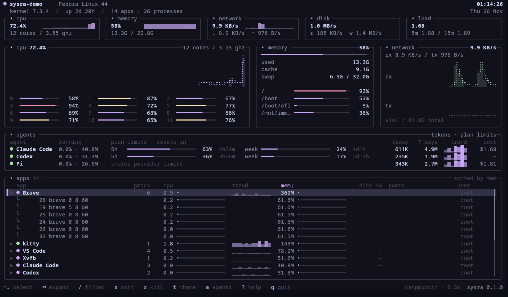

#### Help menu

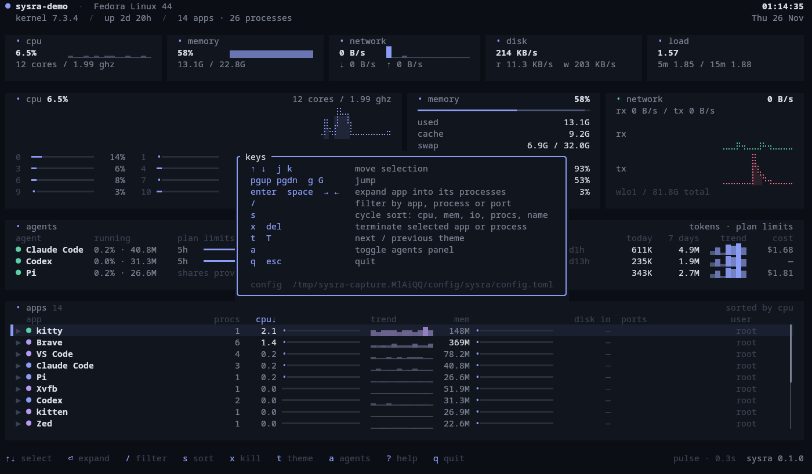

</details>

## Features

- CPU, memory, network throughput, disk I/O, and load at a glance. CPU and network panels show recent history. The memory panel shows cache, swap, and disk space.
- One row per app. Sort by CPU, memory, disk I/O, process count, or name. Filter by app, process name, or port. Expand a row to see its processes.
- Token totals for today and the last seven days, with per-agent trends, costs where recorded, and plan-limit reset countdowns where available.
- Eight built-in themes, custom TOML palettes, filled or outlined panels, and support for transparent terminals.

### Process grouping

sysra follows each process's parent chain to a launcher, such as a desktop session, terminal, shell, or process supervisor. Children of the app under that launcher are grouped with the app.

- If Claude Code starts `bash -c "cargo build"`, the shell and compiler appear under Claude Code.
- If you start Claude Code from a terminal shell, Claude Code and the terminal appear as separate apps. A recognized coding agent also gets its own row when launched inside an editor.
- Launches with the same app name share a row. `×3` means three launches, not three processes.
- sysra uses project or script names for recognized runtime commands when it can, instead of grouping them all as `node` or `python`.

### Coding agent usage

| Agent | Default data source | Plan limits |
| --- | --- | --- |
| Claude Code | `~/.claude/projects/**/*.jsonl` | Live 5-hour and weekly usage with an existing Claude Code login |
| Codex | `~/.codex/sessions/**/*.jsonl` and `~/.codex/archived_sessions/**/*.jsonl` | Latest available 5-hour and weekly windows from local logs |
| Pi | `~/.pi/agent/sessions/**/*.jsonl` | Uses provider limits rather than a separate quota |
| OpenCode | `~/.local/share/opencode/opencode.db` | Not shown |
| Hermes | `~/.hermes/state.db` | Uses provider limits rather than a separate quota |

sysra reads session files and databases without modifying them. The only outbound request is for live Claude plan limits. It uses your existing Claude Code login and caches the result for five minutes under `~/.cache/sysra/` on Linux by default. Set `claude_live_limits = false` under `[agents]` to keep token tracking without the request.

Override data locations with `CLAUDE_CONFIG_DIR`, `CODEX_HOME`, `PI_CODING_AGENT_DIR`, `HERMES_HOME`, or `XDG_DATA_HOME` (for OpenCode).

## Installation

### Prebuilt binaries

The install command at the top downloads the latest [GitHub release](https://github.com/utpalsinghdev/sysra/releases/latest). It picks the archive for your OS and CPU, verifies its SHA-256 checksum, and installs `sysra` to `~/.local/bin`.

Run `sysra` after installation. If the shell cannot find it, add `~/.local/bin` to your `PATH` or run `~/.local/bin/sysra`.

| Installer setting | Default | Example |
| --- | --- | --- |
| `SYSRA_VERSION` | Latest stable release | `v0.1.0` |
| `SYSRA_INSTALL_DIR` | `~/.local/bin` | `$HOME/bin` |
| `SYSRA_DOWNLOAD_URL` | GitHub release asset URL | Base URL of a mirror that hosts both the archives and their checksums |

For example, to install a specific release:

```sh
curl -fsSL https://raw.githubusercontent.com/utpalsinghdev/sysra/main/install.sh |
  SYSRA_VERSION=v0.1.0 sh
```

To install manually, download `sysra-<target>.tar.gz` and its `.sha256` file from the same release. Check the archive with `sha256sum -c <archive>.sha256` on Linux or `shasum -a 256 -c <archive>.sha256` on macOS. Extract the archive and move `sysra` to a directory on your `PATH`.

| Platform | x86_64 | arm64 |
| --- | --- | --- |
| Linux (static musl) | `x86_64-unknown-linux-musl` | `aarch64-unknown-linux-musl` |
| macOS | `x86_64-apple-darwin` | `aarch64-apple-darwin` |

### Build from source

If there is no published binary for your platform, use a current stable [Rust toolchain](https://rustup.rs/) and a C compiler. On macOS, install Xcode Command Line Tools with `xcode-select --install` if needed.

```sh
cargo install --locked --git https://github.com/utpalsinghdev/sysra
```

From a local checkout, use `cargo install --locked --path .` instead. Cargo installs `sysra` to `~/.cargo/bin` by default.

## Keybindings

| Key | Action |
| --- | --- |
| `↑` / `k`, `↓` / `j` | Move the selection |
| `PgUp`, `PgDn` | Move ten rows |
| `Home` / `g`, `End` / `G` | Jump to the first or last row |
| `Enter` / `Space`, `→`, `←` | Toggle, expand, or collapse the selected app |
| `/` | Filter by app name, process name, or port. `Enter` keeps the filter. `Esc` clears it. |
| `s` | Cycle sort order: CPU, memory, disk I/O, process count, name |
| `x` / `Del` | Request `SIGTERM` for the selected app or process. Confirm with `y` or `Enter`. |
| `t`, `T` | Cycle to the next or previous theme for this run |
| `a` | Toggle the agents panel if enabled in configuration |
| `?` / `h` | Open help |
| `q` / `Ctrl+C`, `Esc` | Quit. With a filter active, `Esc` clears it first. |

## Themes

Set `theme = "nord"` in your [config file](#configuration) to keep a theme, or try it for one run:

```sh
sysra --list-themes
sysra --theme nord
```

### Built-in themes

`pulse` is the default. The previews below are crops of the running dashboard in each palette.

<details>
<summary>Preview all eight themes</summary>

| Pulse | Tokyo Night |
| --- | --- |
| 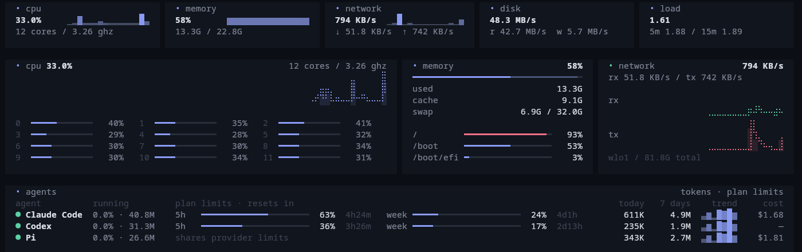 | 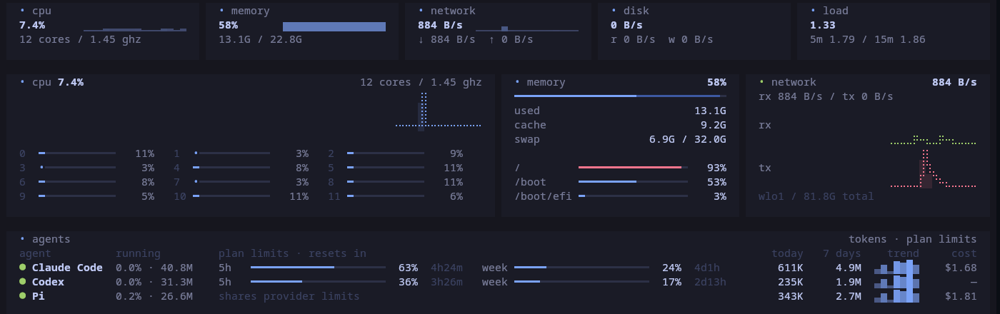 |
| **Catppuccin** | **Rose Pine** |
| 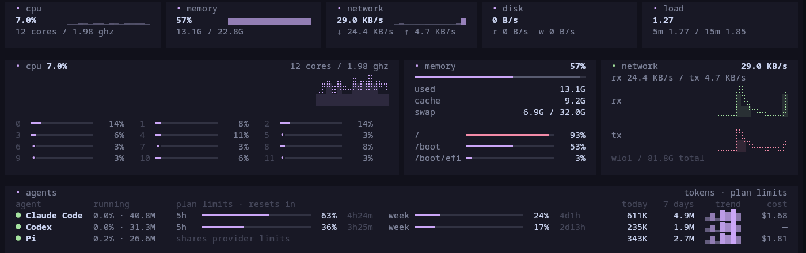 | 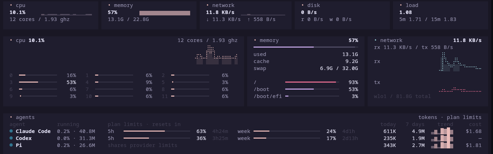 |
| **Nord** | **Gruvbox** |
| 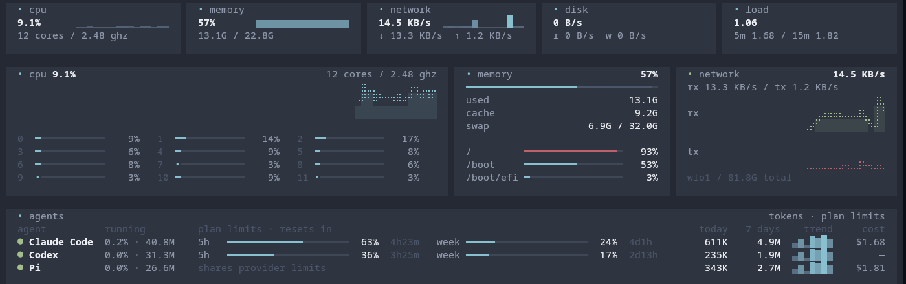 | 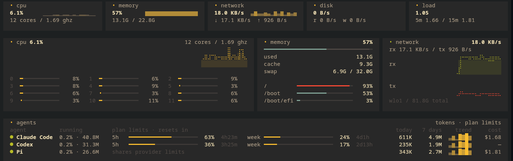 |
| **Dracula** | **Paper** |
| 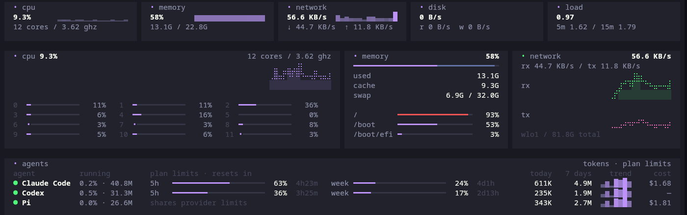 | 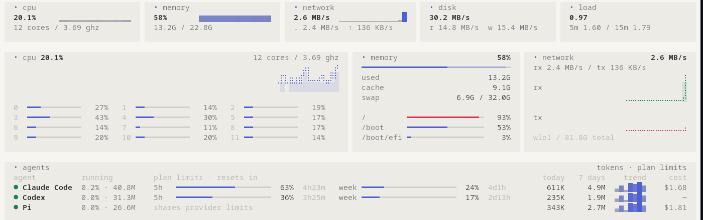 |

</details>

### Custom themes

Create `themes/ember.toml` in the sysra config directory. Use a new name so the file does not shadow a built-in theme.

```toml
extends = "tokyo-night"

[colors]
bg = "#0f1117"
panel = "#161925"
accent = "#ff9e64"
```

If you omit `extends`, the base is `pulse`. Select the file by its stem with `sysra --theme ember`, `theme = "ember"`, or `t` in the UI. Config-level `[colors]` overrides apply on top of the selected theme.

Color keys: `bg`, `panel`, `border`, `text`, `dim`, `faint`, `accent`, `select`, `cpu_low`, `cpu_mid`, `cpu_high`, `mem`, `cache`, `rx`, `tx`, `disk`, `ok`, `warn`, `crit`. Use `#rrggbb`, `#rgb`, an ANSI color name such as `cyan`, or `reset` for the terminal default.

## Configuration

Generate a starter config:

```sh
sysra --init-config
```

This creates `config.toml` and a `themes/` directory without overwriting an existing config. Both live in `~/.config/sysra` by default, or `$XDG_CONFIG_HOME/sysra` when `XDG_CONFIG_HOME` is an absolute path. `--config <PATH>` selects a different config file but does not move the `themes/` directory.

If the config file is missing, sysra uses defaults. Unknown config keys are errors. CLI flags override the corresponding settings for that run.

### Config file options

| TOML setting | Default | Effect |
| --- | --- | --- |
| `theme` | `"pulse"` | Built-in name or custom theme file stem |
| `refresh_ms` | `1000` | System sample interval in milliseconds, limited to `200`–`10000` |
| `transparent` | `false` | Leave the main and panel backgrounds to the terminal |
| `panel_style` | `"filled"` | Paint panel backgrounds, or use `"outline"` for rounded borders |
| `[colors]` | Empty | Override individual [theme colors](#custom-themes) |
| `agents.enabled` | `true` | Enable the agents panel and usage sampling |
| `agents.hide` | `[]` | Hide rows for selected IDs: `claude`, `codex`, `pi`, `opencode`, `hermes` |
| `agents.refresh_secs` | `30` | Seconds between scans of local usage data, minimum `5` |
| `agents.claude_live_limits` | `true` | Fetch live Claude plan limits with your existing Claude Code login |

Example config for a transparent terminal with local-only token tracking:

```toml
theme = "nord"
transparent = true
panel_style = "outline"

[colors]
accent = "#88c0d0"

[agents]
hide = ["hermes"]
claude_live_limits = false
```

### Command-line options

| Flag | Effect |
| --- | --- |
| `-t`, `--theme <NAME>` | Use a theme for this run |
| `-c`, `--config <PATH>` | Load an alternate TOML file |
| `-r`, `--refresh <MS>` | Override the system sample interval |
| `--transparent` | Leave the terminal background unpainted |
| `--no-agents` | Disable the agents panel and usage sampling for this run |
| `--init-config` | Create the starter config and exit |
| `--list-themes` | List available themes and exit |
| `-h`, `--help` | Show usage and exit |
| `-V`, `--version` | Show the installed version and exit |

## Platform notes

- Use a truecolor terminal and a monospace font with braille and box-drawing glyphs. If panels or columns are missing, enlarge the terminal window.
- On Linux, listening ports come from `/proc`. Your account may not be able to see ports for processes owned by other users.
- macOS does not show listening ports. For live Claude plan limits, sysra can use the existing Claude Code login from Keychain.

## License

[MIT](LICENSE).
